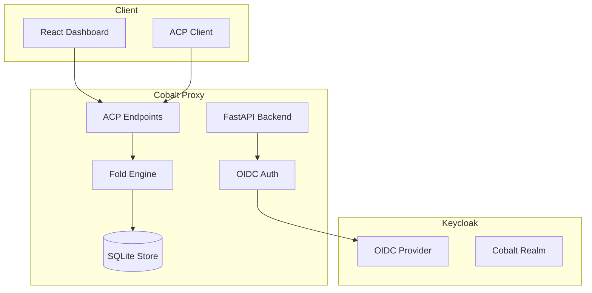

# Cobalt Workbench

> Work in progress. This checkpoint may be incomplete or fail tests. See PLAN.md and STATUS.md before use.


**Alan Vo | AI & Machine Learning**  
alanvo@gmail.com

---

## Overview

Cobalt Workbench is a context-compression plugin for AI/ML developer tools. It enables small context windows (100K context is sufficient), achieves 5x token savings, and supports month-long single sessions with billions of tokens.

The application implements the Agent Context Protocol (ACP) with fold-based compression, stable message identity, and graceful degradation under representation drift.

## Features

- **Context Compression**: Fold-based compression reducing token usage by ~5x
- **Long Sessions**: Support for month-long conversations with billions of tokens
- **ACP Protocol**: Standard endpoints for compress, decompress, search_context, and status
- **Multi-Agent Sessions**: Sessions keyed by (agent_namespace, conversation_id)
- **Real-time Dashboard**: React frontend showing active sessions, fold history, and token savings
- **OIDC Authentication**: Keycloak integration with PKCE, role-based access (viewer, operator, admin)
- **Configurable Limits**: Separate receive/decoded/outbound body size limits with structured 413 errors
- **LLM Advisory**: Optional LLM explanations for compression decisions (opt-in, provider-agnostic)

## Architecture



## Quick Start

### Prerequisites

- Docker and Docker Compose
- Node.js 24+ (for frontend development)
- Python 3.12+ (for backend development)

### Development Setup

1. Clone the repository
2. Copy environment template:
   ```bash
   cp .env.example .env
   ```
3. Start all services:
   ```bash
   docker compose up -d
   ```
4. Access the dashboard at http://localhost:3080
5. Backend API at http://localhost:8787
6. Keycloak admin at http://localhost:8080 (admin/admin)

### Local Development (without Docker)

**Backend:**
```bash
cd backend
python -m venv .venv
source .venv/bin/activate
pip install -r requirements.txt
python -m app.main
```

**Frontend:**
```bash
cd frontend
npm install
npm run dev
```

## API Endpoints

### Health
- `GET /health` — Service health check
- `GET /health/ready` — Readiness probe

### ACP (Agent Context Protocol)
- `GET /acp/status` — Compression status and statistics
- `POST /acp/compress` — Compress conversation history
- `POST /acp/decompress` — Decompress folded history
- `POST /acp/search_context` — Search compressed history (planned)

### Authentication
- `GET /auth/login` — Initiate OIDC login
- `GET /auth/callback` — OIDC callback handler
- `POST /auth/logout` — Logout endpoint

## Configuration

| Variable | Default | Description |
|----------|---------|-------------|
| `ENVIRONMENT` | development | Runtime environment |
| `LOG_LEVEL` | INFO | Logging level |
| `DATABASE_URL` | sqlite+aiosqlite:///./data/sessions.db | Database connection string |
| `KEYCLOAK_URL` | http://localhost:8080 | Keycloak base URL |
| `KEYCLOAK_REALM` | cobalt | Keycloak realm |
| `KEYCLOAK_CLIENT_ID` | cobalt-backend | Backend client ID |
| `ACP_ENABLED` | true | Enable ACP endpoints |
| `ACP_DEFAULT_WINDOW_TOKENS` | 100000 | Default context window |
| `ACP_COMPRESSION_TARGET_RATIO` | 0.2 | Target compression ratio (5x) |
| `ACP_FOLD_THRESHOLD_TOKENS` | 80000 | Tokens before triggering fold |
| `BODY_LIMIT_RECEIVE` | 104857600 | Max request body (100 MiB) |
| `BODY_LIMIT_DECODED` | 209715200 | Max decoded body (200 MiB) |
| `BODY_LIMIT_OUTBOUND` | 104857600 | Max outbound body (100 MiB) |
| `LLM_API_KEY` | (empty) | Optional LLM API key |
| `LLM_PROVIDER` | openai-compatible | LLM provider type |
| `LLM_MODEL` | gpt-4o-mini | LLM model name |

## Testing

### Backend
```bash
cd backend
source .venv/bin/activate
PYTHONPATH=. pytest tests/ -v
PYTHONPATH=. mypy --explicit-package-bases app/
```

### Frontend
```bash
cd frontend
npm test
npm run build
```

## Deployment

### Docker Compose (Production)

```bash
docker compose -f compose.yaml -f compose.prod.yaml up -d
```

### TLS Reverse Proxy

For production, deploy behind a TLS-terminating reverse proxy (nginx, Traefik, Caddy):

```nginx
server {
    listen 443 ssl;
    server_name cobalt.example.com;

    ssl_certificate /path/to/cert.pem;
    ssl_certificate_key /path/to/key.pem;

    location / {
        proxy_pass http://localhost:3080;
        proxy_set_header Host $host;
        proxy_set_header X-Real-IP $remote_addr;
        proxy_set_header X-Forwarded-For $proxy_add_x_forwarded_for;
        proxy_set_header X-Forwarded-Proto $scheme;
    }

    location /api/ {
        proxy_pass http://localhost:8787;
        proxy_set_header Host $host;
        proxy_set_header X-Real-IP $remote_addr;
        proxy_set_header X-Forwarded-For $proxy_add_x_forwarded_for;
        proxy_set_header X-Forwarded-Proto $scheme;
    }
}
```

### Backup & Restore

```bash
# Backup SQLite database
docker compose exec backend cp /app/data/sessions.db /app/data/sessions.db.backup

# Restore
docker compose exec backend cp /app/data/sessions.db.backup /app/data/sessions.db
```

## Security

- **No hardcoded secrets**: All credentials via environment variables
- **Non-root containers**: Both services run as unprivileged users
- **HttpOnly cookies**: Session tokens never exposed to JavaScript
- **CSRF protection**: Double-submit cookie pattern for state-changing operations
- **Token validation**: RS256 JWT validation with JWKS caching
- **Rate limiting**: Recommended at reverse proxy layer

## AI/ML Evaluation

This project implements context compression for LLM interactions. The compression approach uses fold-based summarization with stable anchors, enabling:

- **Baseline**: Uncompressed conversation history
- **Method**: Fold-based compression with content-hash anchors
- **Target**: 5x token reduction (20% of original)
- **Reproducible**: Run `pytest tests/` for backend, `npm test` for frontend

### Limitations

- Compression quality depends on content structure
- LLM explanations are advisory only, never used for critical decisions
- No guarantee of semantic equivalence after compression
- Works best with structured conversation data (code, technical discussions)

## License

MIT License — Copyright (c) 2026 Alan Vo <alanvo@gmail.com>

See [LICENSE](LICENSE) for details.